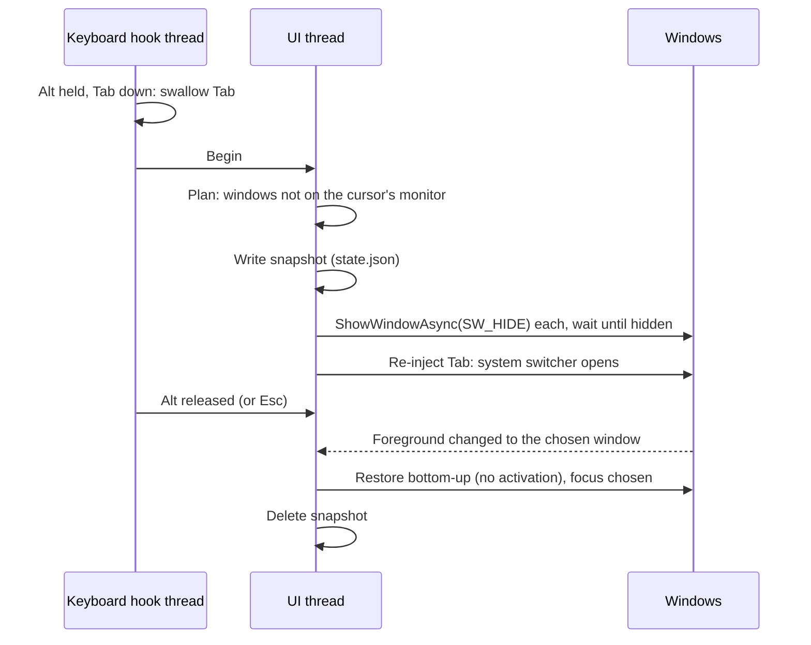

<div align="center">

# MonitorSwitch

**Alt+Tab, but only for the monitor you are looking at.**

[](https://github.com/YamSol/Alt-Tab-per-Monitor/actions/workflows/ci.yml)
[](https://github.com/YamSol/Alt-Tab-per-Monitor/releases)


[Overview](#overview) • [Getting started](#getting-started) • [Usage](#usage) • [How it works](#how-it-works) • [Development](#development)

</div>

## Overview

With several monitors, Windows' Alt+Tab lists the windows of *every* screen. MonitorSwitch is a small tray tool that limits the system switcher to the windows of the monitor under your mouse cursor.

It doesn't replace the switcher. When you press Alt+Tab it briefly hides the windows of the other monitors (`SW_HIDE`), lets Windows show its usual switcher, and puts every hidden window back exactly as it was when you release Alt or press Esc: minimized, maximized, position and Z order.

- **No admin rights.** Runs as you, installs nothing, one `.exe`.
- **Safe by design.** A snapshot is written to disk *before* any window is hidden. If the tool crashes, is killed or you log off, the windows come back on the next start, on exit, or with an emergency hotkey.
- **Per window, not per app.** Dialogs and palettes are judged individually. Modal dialogs, tool windows and windows hidden by their own app are never touched.
- **Virtual desktop aware.** Only the current desktop is considered.
- **View-only mode.** Optionally see what *would* be hidden before letting it hide anything.

> [!NOTE]
> Windows of elevated (admin) processes cannot be hidden by a non-elevated tool (UIPI); they stay in the switcher. Exclusive full-screen games are out of scope.

## Getting started

1. Download the latest release from the [Releases page](https://github.com/YamSol/Alt-Tab-per-Monitor/releases):
   - `MonitorSwitch-<version>-win-x64.zip`: self-contained, works on any Windows 10 21H2+ / 11 x64.
   - `MonitorSwitch-<version>-win-x64-framework-dependent.zip`: tiny; needs the [.NET 8 Desktop Runtime](https://dotnet.microsoft.com/download/dotnet/8.0).
2. Extract and run `MonitorSwitch.exe`. An icon (two small screens) appears in the tray, and it is active right away: Alt+Tab now lists only the windows of the monitor under the cursor.
3. The first line of the tray menu shows the state (**active**, **view only (not hiding)** or **disabled**).

> [!TIP]
> Cautious? Choose **Mode → View only** first. Alt+Tab then behaves as usual, and the log and **Show current plan...** show what *would* be hidden. Switch to **Active** when you are happy.

> [!TIP]
> To start it with Windows, put a shortcut to `MonitorSwitch.exe` in `shell:startup`.

## Usage

### Tray menu

| Item | What it does |
| --- | --- |
| *First line* | The effective state: **active**, **view only (not hiding)** or **disabled**. |
| **Enabled** | Turns the tool on or off without exiting. |
| **Mode** | **Active** (default) hides and restores. **View only** logs what would be hidden and changes nothing. |
| **Show current plan...** | Every visible window, grouped by monitor, with the rule that decided it. Double-clicking the icon opens this too. |
| **Exclusions...** | Process names that are never hidden, one per line (e.g. `vlc.exe`). Use this for apps that pause or misbehave when hidden. |
| **Restore all windows** | Brings back everything the tool hid. Same as the emergency hotkey. |
| **Open data folder** | Settings, log and snapshot. |
| **Verbose log** | Logs every switch and every window decision. See [Troubleshooting](#troubleshooting). |

### Keys

| Keys | Effect |
| --- | --- |
| <kbd>Alt</kbd>+<kbd>Tab</kbd> / <kbd>Alt</kbd>+<kbd>Shift</kbd>+<kbd>Tab</kbd> | System switcher, current monitor only. |
| <kbd>Esc</kbd> while switching | Cancel: everything restored, focus unchanged. |
| <kbd>Ctrl</kbd>+<kbd>Alt</kbd>+<kbd>Shift</kbd>+<kbd>F12</kbd> | Emergency restore (configurable). |

### Command line

```powershell
MonitorSwitch.exe              # run in the tray
MonitorSwitch.exe --list       # print each monitor's windows and what would be hidden
MonitorSwitch.exe --list-all   # same, including windows the rules ignore
MonitorSwitch.exe --restore    # restore windows left hidden by a previous run

# options, combine with any of the above
--verbose                      # detailed log for this run
--data-dir <folder>            # settings, log and snapshot in <folder> (portable / side-by-side copy)
```

### Settings

`%LOCALAPPDATA%\MonitorSwitch\settings.json` (created when you change something in the tray):

```jsonc
{
  "Enabled": true,
  "Mode": "Active",                         // or "ViewOnly"
  "ExcludedProcesses": [],                  // e.g. ["vlc.exe", "obs64"]
  "EmergencyHotkey": "Ctrl+Alt+Shift+F12",
  "OwnedFollowsOwner": true,                // hide a dialog together with its hidden owner
  "DeferFirstTab": true,                    // hide before the switcher draws (see below)
  "HideTimeoutMs": 100,
  "RestoreDelayMs": 250,
  "VerboseLog": false                       // same as the tray's "Verbose log"
}
```

The same folder holds `monitorswitch.log` (handles and process names only, never window titles or keystrokes) and, while windows are hidden, `state.json`.

### Troubleshooting

- **Check the log first.** `monitorswitch.log` records every startup step (version, data folder, monitors, hotkey, keyboard hook, `Ready in N ms`) and every error with its stack trace. If the last line is not `Ready`, the step after the last line is the one that failed.
- **Turn on verbose logging** (tray → **Verbose log**, or start with `--verbose`) to see every Alt+Tab: when it began, whether Tab was held back and re-sent, which windows were hidden or kept and why, how each one was restored, and which window got focus.
- **The process disappears with nothing in the log**: look in *Event Viewer → Windows Logs → Application* for a `.NET Runtime` error (event 1026) naming `MonitorSwitch.exe`. It contains the exception.
- **Windows stuck hidden**: press the emergency hotkey, use **Restore all windows**, or run `MonitorSwitch.exe --restore`.

## How it works



Which windows are hidden:

| Window | Hidden when on another monitor? |
| --- | --- |
| Visible top-level window with a title | Yes |
| Minimized window | Yes, and restored minimized |
| Owned window with a title (dialog, palette) | Yes, judged on its own monitor; also hidden when its owner is |
| Owned modal window (owner disabled) | Never: hiding it can lock the app |
| Owned window without a title, tool window, child window | Never |
| Window already hidden before Alt+Tab | Never, and never "restored" |
| Excluded process, other virtual desktop, cloaked window | Never |

Design notes live in [`docs/decisions`](docs/decisions); the original specification is [`Spec v2 Alternador de janelas por monitor (Windows).md`](Spec%20v2%20Alternador%20de%20janelas%20por%20monitor%20(Windows).md).

## Development

Requirements: Windows 10/11 and the .NET 8 SDK. The repo pins it with [mise](https://mise.jdx.dev/) (`mise.toml`) and `global.json`.

```powershell
mise install                                   # .NET SDK
mise exec -- dotnet test                       # unit + integration tests
mise exec -- dotnet run --project src/MonitorSwitch.App -- --list
```

| Project | Role |
| --- | --- |
| `src/MonitorSwitch.Core` | All decisions: classification rules, plan, snapshot, restore, Alt+Tab state machine, settings. No Win32, so it builds and tests on any OS. |
| `src/MonitorSwitch.Win32` | P/Invoke: window enumeration, hide/show, keyboard hook, input injection, virtual desktops. |
| `src/MonitorSwitch.App` | Tray app, wiring and CLI. |
| `tests/MonitorSwitch.Core.Tests` | Unit tests against an in-memory desktop. |
| `tests/MonitorSwitch.Win32.Tests` | Integration tests that create, hide and restore real windows, including the 30-window latency check. |

> [!IMPORTANT]
> The Win32 tests open and hide their own windows on your desktop for a few seconds. They are scoped so that no other window can be touched.

**CI** (GitHub Actions) builds and runs both test suites on Windows. Core also runs on Linux to keep it platform-neutral. CI publishes a coverage report to the job summary and fails below 80% total / 90% Core line coverage. **Releases** are cut by pushing a tag:

```powershell
git tag v0.1.0; git push origin v0.1.0
```

A few behaviours need two physical monitors and real key presses; [`docs/manual-acceptance.md`](docs/manual-acceptance.md) is the checklist to run before tagging.
